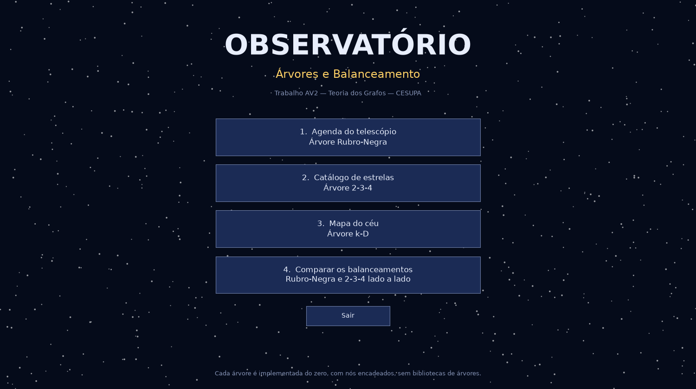
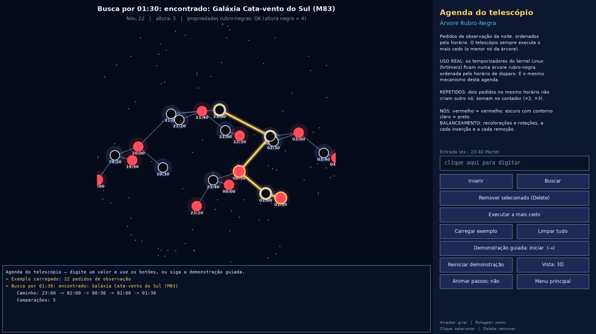
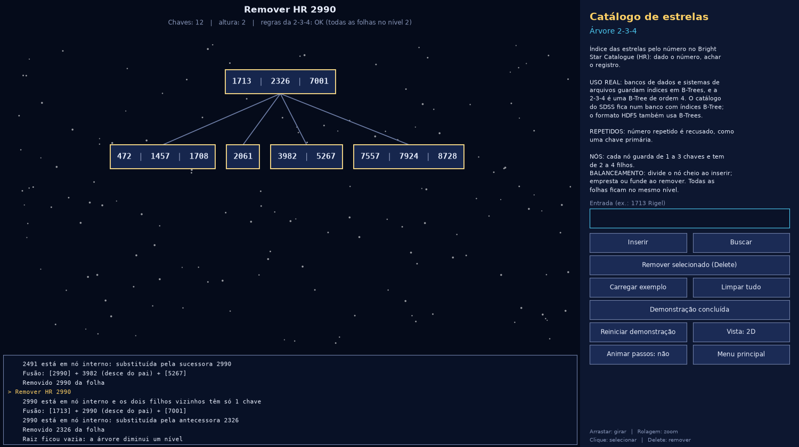
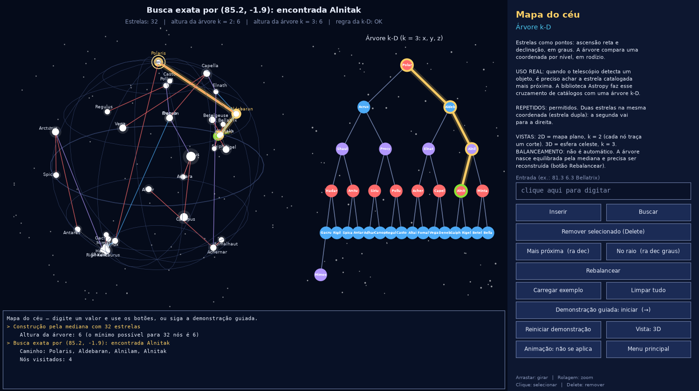
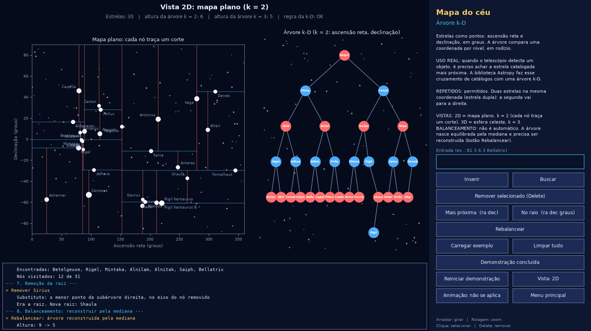
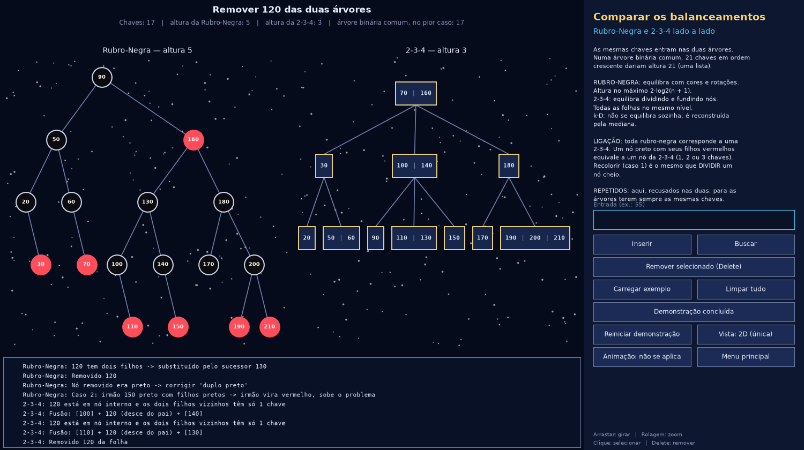

# Observatório — Árvores e Balanceamento

Trabalho Avaliativo AV2 (Parte 1) — Teoria dos Grafos — CESUPA

Três árvores implementadas do zero em Python, sem nenhuma biblioteca de árvores, aplicadas a um mesmo problema: o software de um observatório astronômico. Cada árvore cuida da parte em que ela é usada em sistemas reais, e todas podem ser vistas e editadas num modelo 3D navegável.



## Integrantes

- André Felipe Ribeiro Fernandes
- Lucas Sousa Jatene
- Brenno Yasuhei Tsuchiya
- Gustavo Alencar Sabóia Lobato

## Apresentação

[Slides no Canva](https://www.canva.com/design/DAHZnt_s2YQ/8Kr_Ssmix_L-WSR88pZl6A/edit)

## Como executar

Requisitos: Python 3.9 ou mais novo. A única dependência é o matplotlib.

```bash
git clone https://github.com/Galencar14/Trabalho-Avaliativo---Implementa-o-de-rvores-e-Balanceamento.git
cd Trabalho-Avaliativo---Implementa-o-de-rvores-e-Balanceamento
pip install -r requirements.txt
python main.py
```

Abre uma janela com o menu. Escolha um módulo; o botão **Menu principal** volta para a tela inicial.

Teste de corretude das três árvores:

```bash
python teste_aleatorio.py
```

## Como usar a janela

Cada módulo tem a árvore à esquerda, os botões à direita e o registro das operações embaixo. O registro mostra o que a árvore fez em cada operação (qual caso de balanceamento, qual rotação, qual divisão).

| Ação | Como fazer |
|---|---|
| Girar o modelo 3D | arrastar com o mouse (os nomes dos nós somem durante o giro, para ele ficar fluido, e voltam ao soltar) |
| Aproximar e afastar | rolagem do mouse |
| Selecionar um nó | clicar nele |
| Remover o nó selecionado | tecla `Delete` ou o botão **Remover selecionado** |
| Inserir ou buscar | clicar no campo **Entrada**, digitar e clicar em **Inserir** ou **Buscar** (`Enter` também insere) |
| Buscar um nó sem digitar | clicar no nó e depois em **Buscar** (ou tecla `B`) |
| Ver o caminho de uma busca | depois de **Buscar**, uma linha amarela percorre as arestas da raiz até onde a busca terminou, encontrando ou não |
| Apagar a árvore inteira | botão **Limpar tudo** |
| Demonstração guiada | botão **Demonstração guiada** ou seta para a direita, um passo por vez |
| Alternar entre 3D e 2D | botão **Vista** |
| Ver cada rotação ou divisão separadamente | botão **Animar passos** |

A árvore sempre reage pelas próprias regras: remover um nó da rubro-negra dispara recolorações e rotações, remover uma chave da 2-3-4 dispara empréstimo ou fusão, e remover uma estrela da k-D troca o nó pelo menor da subárvore direita. A janela só desenha o resultado.

## Os módulos

| Módulo | Árvore | Chave | O que faz |
|---|---|---|---|
| Agenda do telescópio | Rubro-Negra | horário da observação | Recebe pedidos em qualquer ordem e executa sempre o mais cedo |
| Catálogo de estrelas | 2-3-4 | número da estrela no catálogo | Cadastra, remove e consulta estrelas pelo número |
| Mapa do céu | k-D | posição da estrela | Acha a estrela mais próxima de um ponto e as estrelas em volta dele |
| Comparar os balanceamentos | Rubro-Negra e 2-3-4 | número | Mostra as duas árvores lado a lado com as mesmas chaves |

### 1. Agenda do telescópio — Árvore Rubro-Negra

A agenda precisa aceitar pedidos em qualquer ordem e entregar sempre o mais cedo. Na rubro-negra as duas operações custam O(log n), porque a árvore se rebalanceia a cada inserção e a cada remoção.

**Uso real:** os temporizadores de alta resolução do kernel Linux (`hrtimers`) ficam numa árvore rubro-negra ordenada pelo horário de disparo. É o mesmo mecanismo desta agenda.

No desenho, o nó vermelho é vermelho e o nó preto é escuro com contorno claro, para aparecer sobre o céu.



### 2. Catálogo de estrelas — Árvore 2-3-4

Um índice: dado o número da estrela, achar o registro dela.

**Uso real:** bancos de dados guardam seus índices em B-Trees, e a árvore 2-3-4 é uma B-Tree de ordem 4. O levantamento SDSS, um dos maiores mapeamentos do céu, é servido por um banco SQL Server com índices em B-Tree. O formato HDF5, comum em dados científicos, também usa B-Trees por dentro.

Em 3D, cada nó é um aglomerado de 1 a 3 estrelas, uma por chave.



### 3. Mapa do céu — Árvore k-D

Cada estrela é um ponto, e a árvore compara uma coordenada por nível, em rodízio. O módulo mantém duas árvores k-D com as mesmas estrelas, uma para cada vista:

- **Vista 2D (k = 2):** pontos (ascensão reta, declinação) num mapa plano. Cada nó traça uma linha que divide a região que recebeu do pai. É a melhor vista para entender a ideia.
- **Vista 3D (k = 3):** pontos (x, y, z) na esfera celeste. É como os programas reais fazem, porque o céu é uma esfera.

O código da árvore é o mesmo nas duas; só muda o número de coordenadas, que é o "k" do nome. Toda inserção e remoção é aplicada nas duas árvores.

**Uso real:** quando um telescópio detecta um objeto, é preciso descobrir a qual estrela conhecida ele corresponde, ou seja, achar a estrela catalogada mais próxima. A biblioteca Astropy, padrão na astronomia, faz esse cruzamento de catálogos com uma árvore k-D.





### 4. Comparar os balanceamentos

As mesmas 21 chaves entram, em ordem crescente, na Rubro-Negra e na 2-3-4. Ordem crescente é o pior caso de uma árvore binária comum, que ficaria com altura 21.



## Elementos repetidos

Cada árvore trata repetidos de um jeito, escolhido de acordo com o problema:

| Árvore | Regra | Motivo no observatório |
|---|---|---|
| Rubro-Negra | **Contador no nó.** Inserir uma chave que já existe não cria nó: o campo `quantidade` aumenta. Remover diminui o contador, e o nó só sai da árvore quando chega a zero. | Dois pedidos para o mesmo horário formam uma fila naquele horário |
| 2-3-4 | **Recusados.** A inserção devolve `False` e a árvore não muda. | O número de catálogo identifica uma única estrela (chave primária) |
| k-D | **Permitidos.** O ponto repetido vai para a subárvore direita (regra "maior ou igual"). A remoção tira uma cópia por vez. | Duas estrelas podem estar na mesma coordenada (estrelas duplas) |

Cada demonstração guiada tem uma fase só para mostrar essa regra.

## Balanceamento

| | Rubro-Negra | 2-3-4 | k-D |
|---|---|---|---|
| **Tipo** | binária | não binária (2 a 4 filhos) | binária, com k coordenadas |
| **O que equilibra** | cores e rotações | divisão e fusão de nós | escolha da mediana na construção |
| **Inserção** | O nó novo entra vermelho. **Caso 1** (tio vermelho): recolore pai, tio e avô, e o problema sobe. **Caso 2** (tio preto, nó interno): rotaciona o pai e vira o caso 3. **Caso 3** (tio preto, nó externo): recolore e rotaciona o avô. | Na descida, todo nó cheio (3 chaves) é dividido em dois e a chave do meio sobe para o pai. | Não rebalanceia. |
| **Exclusão** | Só corrige se o nó removido era preto ("duplo preto"). **Caso 1** (irmão vermelho): recolore e rotaciona o pai. **Caso 2** (irmão preto, sobrinhos pretos): irmão fica vermelho, e o problema sobe. **Caso 3** (sobrinho interno vermelho): rotaciona o irmão e vira o caso 4. **Caso 4** (sobrinho externo vermelho): recolore e rotaciona o pai. | Na descida, todo filho com só 1 chave pega uma emprestada de um irmão (rotação pelo pai) ou é fundido com ele. | Não rebalanceia. O nó removido é substituído pelo ponto de menor coordenada, no eixo dele, da subárvore direita. |
| **Garantia** | altura ≤ 2·log₂(n + 1) | todas as folhas no mesmo nível | só logo após construir ou reconstruir |
| **Onde a árvore cresce** | nas folhas | na raiz | nas folhas |

Ligação entre as duas primeiras: toda rubro-negra corresponde a uma 2-3-4. Um nó preto junto com seus filhos vermelhos equivale a um nó da 2-3-4 (preto sozinho = 1 chave, com um filho vermelho = 2 chaves, com dois = 3 chaves). Recolorir na rubro-negra (caso 1) é o mesmo que dividir um nó cheio na 2-3-4.

A k-D não tem balanceamento automático. A construção pela mediana gera uma árvore equilibrada, e depois de muitas inserções o remédio é reconstruir (botão **Rebalancear**). A demonstração mostra isso: a altura vai de 5 para 9 com as inserções e volta a 5 depois da reconstrução.

## Estruturas de dados usadas

- **Rubro-Negra:** nós encadeados ao estilo de lista duplamente encadeada. Cada nó aponta para o filho esquerdo, o filho direito e o pai. Um único nó sentinela `NIL`, preto, faz o papel de todas as folhas vazias.
- **2-3-4:** nós encadeados, do pai para os filhos. Dentro de cada nó, as chaves (até 3), os valores e os ponteiros para os filhos (até 4) ficam em **listas do Python**, porque a quantidade varia. Não há ponteiro para o pai: como a árvore divide e funde nós na descida, nunca é preciso voltar.
- **k-D:** nós encadeados com filho esquerdo e direito. Cada ponto é uma tupla.
- **Estruturas auxiliares:** uma lista usada como pilha no percurso em ordem da rubro-negra, e listas e conjuntos para guardar os caminhos percorridos, usados só para exibição.

## Ferramentas

Tudo o que o projeto usa é gratuito e de código aberto:

- **Python**, com a biblioteca padrão.
- **matplotlib**, para a janela inteira: desenho 2D e 3D, botões, campo de texto, mouse e teclado.

Nenhuma biblioteca de árvores ou de grafos é usada. As três árvores estão em `rubro_negra.py`, `arvore234.py` e `arvore_kd.py`, que não importam nada além do módulo `math`.

## Arquivos

| Arquivo | Conteúdo |
|---|---|
| `main.py` | Abre a janela |
| `rubro_negra.py` | Árvore Rubro-Negra |
| `arvore234.py` | Árvore 2-3-4 |
| `arvore_kd.py` | Árvore k-D |
| `agenda.py`, `catalogo.py`, `mapa.py`, `comparacao.py` | Os quatro módulos: traduzem os botões em operações da árvore e definem a demonstração guiada |
| `controle.py` | Interface comum dos módulos |
| `janela.py` | A janela: tela inicial, painel de botões, clique, teclado e registro |
| `desenho.py` | Desenho das árvores em 2D e em 3D |
| `dados.py` | Estrelas e pedidos de observação do exemplo |
| `teste_aleatorio.py` | Teste das três árvores com operações aleatórias |

## Versões anteriores

As branches `rubro-negra`, `arvore-2-3-4` e `arvore-kd` guardam as primeiras versões de cada árvore, feitas separadamente e com exemplos próprios. A versão da entrega é esta, na branch `main`, que reúne as três no mesmo programa.

## Requisitos do trabalho

| Requisito | Onde está |
|---|---|
| Nós encadeados, sem biblioteca de árvores | `rubro_negra.py`, `arvore234.py`, `arvore_kd.py` |
| Aplicação em um problema específico | Agenda, catálogo e mapa do observatório |
| Inserção com balanceamento | Fase 1 de cada demonstração e botão **Inserir** |
| Exclusão com balanceamento | Fases 4 e 5 da agenda, fase 4 do catálogo, fase 7 do mapa, e tecla `Delete` em qualquer nó |
| Busca | Fase 3 da agenda e do catálogo, fases 4 a 6 do mapa, e botão **Buscar** |
| Árvores binárias com pelo menos 21 nós | Agenda: 22 nós. Mapa: 24 estrelas na construção, 31 no total |
| Tratamento de repetidos definido | Seção "Elementos repetidos" e fase própria em cada demonstração |
| Plotagem dos procedimentos | Janela redesenhada a cada operação, em 2D e 3D |
| Diferenças entre os balanceamentos | Módulo 4 e seção "Balanceamento" |
| Instruções de execução | Seção "Como executar" |

## Simplificações

- **Duas medidas de distância no mapa.** Na vista 3D a distância é o ângulo real entre as estrelas na esfera. Na vista 2D ela é medida no mapa plano, que distorce perto dos polos, então uma mesma consulta pode dar respostas um pouco diferentes nas duas vistas.
- **Dados aproximados.** As estrelas são reais, com o número do Bright Star Catalogue (HR), mas as coordenadas estão arredondadas para uma casa decimal e as magnitudes são aproximadas.
- **A agenda não é um escalonador real.** Ela mostra o mecanismo (ordenar por horário e tirar o menor), não as regras de prioridade de um observatório de verdade.

## Referências dos usos reais

- Temporizadores do kernel Linux em árvore rubro-negra: [documentação `hrtimers` do kernel](https://mjmwired.net/kernel/Documentation/timers/hrtimers.txt)
- Banco de dados do SDSS com índices em B-Tree: [The SDSS SkyServer (artigo)](https://arxiv.org/pdf/cs/0111015)
- B-Trees no formato HDF5: [especificação do formato HDF5](https://support.hdfgroup.org/documentation/hdf5/latest/_f_m_t3.html)
- Cruzamento de catálogos com árvore k-D no Astropy: [`match_coordinates_sky`](https://astropy.readthedocs.io/en/stable/api/astropy.coordinates.match_coordinates_sky.html)
