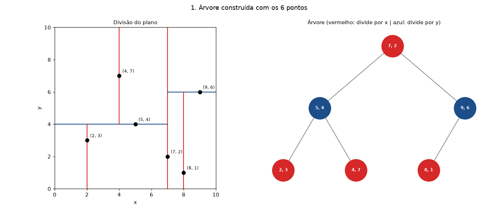
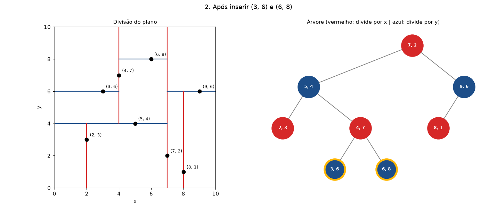
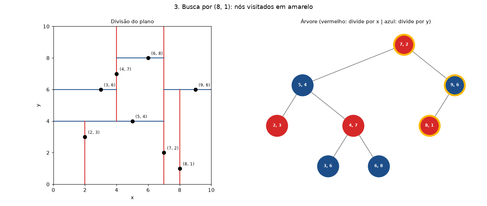
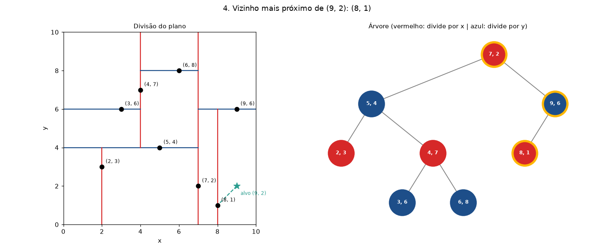
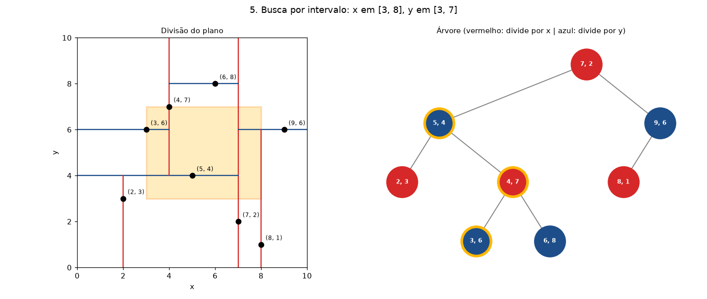
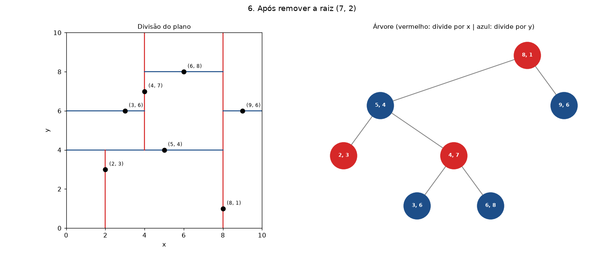

# Árvore k-D — Explicação detalhada com exemplo

Trabalho Avaliativo AV2 (Parte 1) — Teoria dos Grafos — CESUPA

Esta branch explica a árvore k-D passo a passo, sempre com o mesmo exemplo, e traz uma implementação do zero em Python (sem bibliotecas de árvore) que reproduz cada passo da explicação.

| Arquivo | Conteúdo |
|---|---|
| `arvore_kd.py` | A árvore: construção pela mediana, inserção, busca exata, vizinho mais próximo, busca por intervalo, remoção e validação |
| `plotagem.py` | Figura com o plano dividido e a árvore, lado a lado (matplotlib) |
| `main.py` | Demonstração que executa o exemplo deste README e salva as figuras em `imagens/` |
| `teste_aleatorio.py` | 200 rodadas aleatórias comparando cada resposta da árvore com a força bruta |

## 1. O que é

Uma **árvore k-D** (*k-dimensional tree*) é uma árvore binária de busca para **pontos com k coordenadas**: (x, y) no plano, (x, y, z) no espaço e assim por diante.

Uma árvore binária de busca comum guarda números e compara o número inteiro. Um ponto tem várias coordenadas, então a árvore k-D compara **uma coordenada por nível**, revezando:

| Nível | Coordenada comparada (k = 2) |
|---|---|
| 0 (raiz) | x |
| 1 | y |
| 2 | x |
| 3 | y |

Em geral: `eixo = nível % k`.

Regra de cada nó, usando a coordenada do nível dele:

- subárvore **esquerda**: pontos com coordenada **menor** que a do nó;
- subárvore **direita**: pontos com coordenada **maior ou igual**.

Geometricamente, cada nó traça uma linha que corta em duas a região que recebeu do pai: vertical quando compara x, horizontal quando compara y. A árvore inteira é uma divisão do plano em retângulos cada vez menores.

**Para que serve:** responder rápido perguntas de proximidade, como "qual é o ponto mais perto deste aqui?" ou "quais pontos estão dentro deste retângulo?". É usada em mapas (loja mais próxima), jogos e computação gráfica (colisão) e aprendizado de máquina (k-vizinhos mais próximos).

## 2. Exemplo: construindo a árvore

Pontos: **(2, 3), (5, 4), (9, 6), (4, 7), (8, 1), (7, 2)**

Para a árvore sair balanceada, em cada nível ordenamos os pontos pela coordenada da vez e escolhemos a **mediana** como nó. Metade dos pontos vai para cada lado.

**Nível 0, compara x.** Ordenados por x: (2, 3), (4, 7), (5, 4), **(7, 2)**, (8, 1), (9, 6). A mediana é **(7, 2)**, que vira a raiz.

- Esquerda (x < 7): (2, 3), (4, 7), (5, 4)
- Direita (x ≥ 7): (8, 1), (9, 6)

**Nível 1, compara y, lado esquerdo.** Ordenados por y: (2, 3), **(5, 4)**, (4, 7). Mediana: **(5, 4)**.

- Esquerda (y < 4): (2, 3)
- Direita (y ≥ 4): (4, 7)

**Nível 1, compara y, lado direito.** Ordenados por y: (8, 1), **(9, 6)**. Mediana: **(9, 6)**.

- Esquerda (y < 6): (8, 1)
- Direita: vazia

Resultado:

```
                 (7, 2)              nível 0: compara x
                /      \
           (5, 4)      (9, 6)        nível 1: compara y
           /    \       /
      (2, 3)  (4, 7)  (8, 1)         nível 2: compara x
```



Na figura, as linhas vermelhas são os cortes por x e as azuis os cortes por y. Cada linha só existe dentro da região do seu nó: a linha de (5, 4) vai só até x = 7, porque (5, 4) está à esquerda da raiz.

## 3. Inserção

Desce como na busca, comparando a coordenada do nível, até achar um lugar vazio.

**Inserir (3, 6):**

1. Raiz (7, 2), compara x: 3 < 7 → esquerda.
2. (5, 4), compara y: 6 ≥ 4 → direita.
3. (4, 7), compara x: 3 < 4 → esquerda, que está vazia. **(3, 6) entra aqui.**

**Inserir (6, 8):** 6 < 7 → esquerda; 8 ≥ 4 → direita; 6 ≥ 4 → direita de (4, 7).



A inserção **não rebalanceia**. Depois de muitas inserções a árvore pode ficar torta; a solução usual é reconstruí-la pela mediana de tempos em tempos.

## 4. Busca exata

Igual à inserção: em cada nó, compara só a coordenada do nível.

**Buscar (8, 1):** (7, 2): 8 ≥ 7 → direita. (9, 6): 1 < 6 → esquerda. (8, 1): achou, visitando 3 nós.

**Buscar (6, 6):** (7, 2) → (5, 4) → (4, 7) → (6, 8) → lugar vazio. Não existe.



## 5. Vizinho mais próximo

É a operação mais importante da árvore k-D. Pergunta: **qual ponto da árvore está mais perto de (9, 2)?**

A ideia tem duas partes:

1. Descer primeiro pelo lado onde o alvo está, guardando o melhor ponto encontrado.
2. Na volta, só entrar no outro lado de um nó se a **linha divisória** dele estiver mais perto do alvo que o melhor ponto já achado. Se a linha está mais longe, nada do outro lado pode ganhar, e o ramo inteiro é descartado (**poda**).

Passo a passo para o alvo (9, 2):

| Nó visitado | Distância até o alvo | Melhor até agora | Decisão |
|---|---|---|---|
| (7, 2) | 2,000 | (7, 2) | 9 ≥ 7: o alvo está à direita, desce para lá |
| (9, 6) | 4,000 | (7, 2) | 2 < 6: o alvo está embaixo, desce para a esquerda |
| (8, 1) | 1,414 | **(8, 1)** | folha, começa a voltar |

Na volta:

- Em (9, 6): a linha y = 6 está a 4 de distância do alvo, mais longe que 1,414. O outro lado é descartado (e, neste exemplo, também está vazio).
- Em (7, 2): a linha x = 7 está a 2 de distância do alvo. **2 > 1,414**, então nenhum ponto à esquerda da linha pode estar mais perto que (8, 1). Os 5 pontos da esquerda são descartados sem serem visitados.

**Resposta: (8, 1), distância 1,414, visitando 3 dos 8 pontos.**



Quando a linha divisória está mais perto que o melhor ponto, o outro lado precisa ser visitado. Por isso o custo é O(log n) em média, mas pode chegar a O(n) no pior caso.

## 6. Busca por intervalo

Pergunta: **quais pontos têm x entre 3 e 8 e y entre 3 e 7?**

Em cada nó, a busca só desce para um lado se o retângulo alcança aquele lado da linha divisória. Na raiz (7, 2), o retângulo vai de x = 3 a x = 8 e cruza a linha x = 7, então os dois lados são visitados. Em (9, 6), o retângulo termina em y = 7, acima da linha y = 6, então os dois lados também são visitados, mas (9, 6) e (8, 1) ficam de fora por terem x ou y fora do intervalo.

**Resposta: (3, 6), (4, 7) e (5, 4).**



## 7. Remoção

Remover uma folha é direto. Remover um nó interno exige um substituto que mantenha a regra da árvore:

- **Se o nó tem subárvore direita:** o substituto é o ponto de **menor coordenada, no eixo do nó,** dentro da subárvore direita. Tudo que sobra à direita continua maior ou igual a ele.
- **Se só tem subárvore esquerda:** o substituto é o mínimo da esquerda, e a subárvore esquerda inteira passa para a direita. (Usar o máximo da esquerda quebraria a regra quando há pontos empatados.)

Achar esse mínimo é diferente da árvore binária comum: ele só está garantidamente à esquerda nos níveis que comparam o mesmo eixo. Nos outros níveis é preciso olhar os dois lados.

**Remover a raiz (7, 2)**, que compara x: o menor x na subárvore direita é o de **(8, 1)**. Ele sobe para a raiz e é removido da posição antiga.

```
                 (8, 1)
                /      \
           (5, 4)      (9, 6)
           /    \
      (2, 3)  (4, 7)
              /    \
         (3, 6)  (6, 8)
```



## 8. Custo das operações

| Operação | Árvore balanceada (média) | Pior caso |
|---|---|---|
| Construção pela mediana | O(n log² n) nesta implementação (ordena a cada nível) | igual |
| Inserção | O(log n) | O(n) |
| Busca exata | O(log n) | O(n) |
| Vizinho mais próximo | O(log n) | O(n) |
| Busca por intervalo | O(√n + m), com m pontos encontrados (k = 2) | O(n) |
| Remoção | O(log n) | O(n) |

O pior caso acontece quando a árvore fica desbalanceada (muitas inserções em ordem) ou, no vizinho mais próximo, quando o número de dimensões é alto: com k grande quase nenhum ramo é podado, e a árvore perde a vantagem sobre a força bruta.

## 9. Decisões desta implementação

- **Elementos repetidos:** são permitidos. Um ponto repetido, ou com a mesma coordenada no eixo do nó, vai para a **direita** (regra "maior ou igual"). A remoção tira uma cópia por vez.
- **Balanceamento:** a construção pela mediana gera uma árvore balanceada. Inserção e remoção não rebalanceiam.
- **Distância:** euclidiana.
- **Dimensões:** qualquer k (o teste usa k = 2 e k = 3). As figuras só são geradas para k = 2.

## Como executar

Requisitos: Python 3.9 ou mais novo.

```bash
git clone https://github.com/Galencar14/Trabalho-Avaliativo---Implementa-o-de-rvores-e-Balanceamento.git
cd Trabalho-Avaliativo---Implementa-o-de-rvores-e-Balanceamento
git checkout arvore-kd
pip install -r requirements.txt
python main.py              # executa o exemplo e salva as figuras em imagens/
python teste_aleatorio.py   # teste de corretude
```

## Integrantes

- André Felipe Ribeiro Fernandes
- Lucas Sousa Jatene
- Brenno Yasuhei Tsuchiya
- Gustavo Alencar Sabóia Lobato
